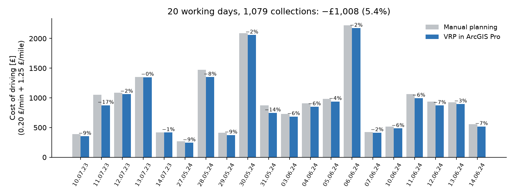
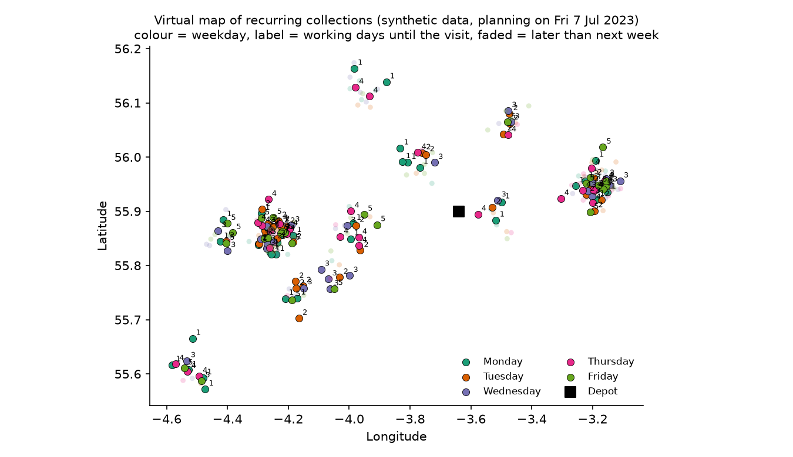
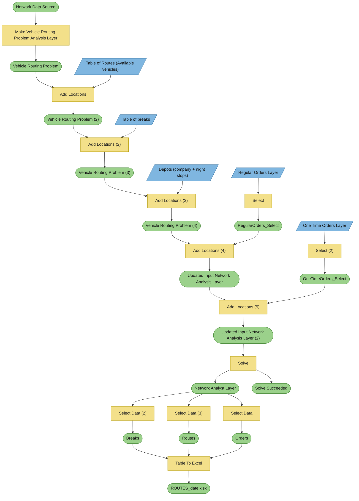
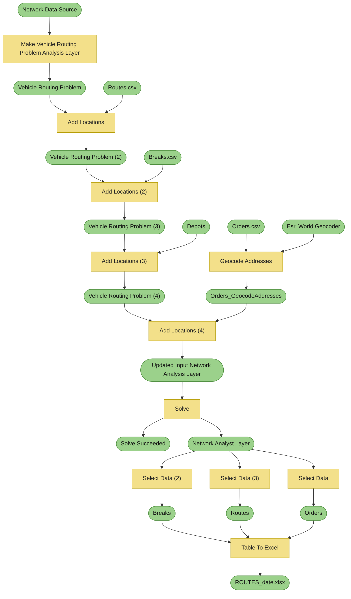
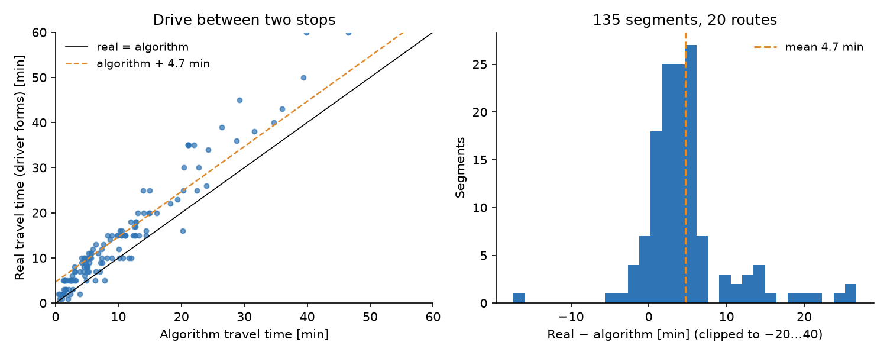

# Fleet Route Planning with ArcGIS Pro (Vehicle Routing Problem)

🇬🇧 **English** · 🇵🇱 [Wersja polska](README.pl.md)

[](https://github.com/MalickiJacek/fleet-routing-vrp-arcgis/actions/workflows/ci.yml)


My MSc thesis project: a GIS workflow that replaced manual route planning in a waste-paper collection company in Scotland. Tested on **20 working days and 1,079 real collections**, it cut driving costs by **5.4%** compared with routes planned by hand, and it reduced daily planning from about 3 hours to 30 minutes.

> Malicki J. (2024). *Application of network analysis for management of fleet of vehicles in a company transporting waste paper.* MSc thesis, Geomatics, Wrocław University of Science and Technology. Supervisor: dr hab. inż. Jan Blachowski.



## The problem

The company collects confidential documents for shredding from several hundred offices, hospitals and shops, using a fleet of about 9 vans and lorries. About half of the collections recur (weekly, every 2, 4 or 6 weeks), and the other half are one-off orders, usually collected within 48 hours.

Before this project:
- **Booking a new order:** the dispatcher checked where vehicles would be on the following days on a 150 × 80 cm paper wall map, in Google Maps and in the CRM.
- **Daily planning:** every evening the coordinator split the next day's jobs by postcode area, ordered each list by hand in Google Maps and typed the routes back into the CRM. This took **about 3 hours a day**.

## The solution – three parts

### 1. Virtual map of recurring orders

All regular orders (702 in the case study) were geocoded into a feature class. Each record stores the service day, the visit frequency and the date of the last visit. A script calculates:
- `NextDate`: the date of the next visit;
- `DaysCount`: the number of working days until that visit.

The symbology then shows the weekday as colour and fades visits that are more than one working week away (an [Arcade expression](arcpy/symbology_transparency.arcade)). When a customer calls, the dispatcher sees at once which day a van will already be nearby.



### 2. Daily VRP in ArcGIS Pro, automated with ModelBuilder

Every evening one model plans the next working day:

1. It selects the orders with `DaysCount = 1`, plus the one-off orders for that date.
2. It loads them into a **Vehicle Routing Problem** layer together with:
   - **Routes:** available vehicles and drivers, with three capacities (bags, 240 L bins, weight), cost per minute and per mile, working-time limits and a 30-minute start and end at the depot;
   - **Breaks:** 15 min around 9:30 and 45 min around 13:00;
   - **Depots:** the yard and an optional night stop for multi-day trips to England.
3. It solves the problem and exports one Excel file for drivers: the stops in sequence with arrival times, plus a summary of each route.

There are two variants: orders taken from the virtual map, or from a spreadsheet geocoded on the fly.

| Virtual map variant | Spreadsheet variant |
|---|---|
|  |  |

### 3. Validation with real driving times

Over one week, drivers filled in a paper form with their arrival and departure times at every stop: 20 routes and 231 stops. After removing segments with missing times, zero length or breaks recorded as driving, **135 drive segments** were compared with the times calculated by Network Analyst.

Reality was slower in 90% of the segments, by **4.7 minutes on average**. This covers leaving premises, parking and vans being slower than the cars the network dataset is tuned for. The value is now applied to every route as `ArriveDepartDelay`, so the planned arrival times match reality better.



## Results

For each of 20 working days (July 2023 and May–June 2024), the routes that had actually been planned by hand were rebuilt in the VRP layer, keeping their manual sequence. The same orders were then solved again, this time letting the algorithm assign and order them freely. The 901 addresses from 2024 were geocoded with my own web app built on OpenStreetMap Nominatim (see also [geoplanner-route-optimizer](https://github.com/MalickiJacek/geoplanner-route-optimizer)); 97% were located automatically. Costs use £0.20 per minute of driving (driver at £12/h) and £1.25 per mile.

| | Manual | VRP | Difference |
|---|---|---|---|
| Collections | 1,079 | 1,079 | |
| Driving time | 18,008 min | 17,168 min | −840 min (−4.7%) |
| Distance | 12,057 mi | 11,384 mi | −672 mi (−5.6%) |
| Cost of driving | £18,673 | £17,665 | **−£1,008 (−5.4%)** |

Estimated over a year (260 working days):

| Item | Per year |
|---|---|
| Driving | about £13,000 |
| Planner time (2.5 h a day) | £7,800 |
| ArcGIS Pro + Network Analyst licence and extra credits | −£2,230 |
| **Net saving** | **about £18,500** |

The per-day data are in [`data/thesis/`](data/thesis/) (aggregated, no customer data). [`src/fleetvrp/analysis.py`](src/fleetvrp/analysis.py) recalculates all the numbers above, and the tests check them.

## Repository structure

```
├── model/         ModelBuilder models as diagrams (+ Mermaid source)
├── arcpy/         00_import_sample_data.py      synthetic CSV -> file geodatabase
│                  01_update_order_schedule.py   NextDate / DaysCount for the virtual map
│                  02_daily_vrp.py               the daily model in Python (arcpy.nax)
│                  symbology_transparency.arcade
├── src/fleetvrp/  schedule.py (visit dates, working days), analysis.py (accuracy, savings)
├── data/sample/   synthetic orders, vehicles, breaks, depots (Central Scotland)
├── data/thesis/   aggregated results: 135 drive segments, 20 days manual vs VRP
├── docs/          vrp_inputs.md (fields of the VRP layer), figures
└── tests/         pytest
```

## How to run

**ArcGIS Pro** (Network Analyst; the ArcGIS Online network data source uses credits): see [`arcpy/README.md`](arcpy/README.md).

**Analysis and figures** (any Python):

```bash
pip install -e ".[dev]"
pytest -q                         # 15 tests
python scripts/make_figures.py    # docs/img/*.png
```

## Data and privacy

Customer names, addresses and vehicle data of the company are **not** published. The thesis results are given as aggregated tables only. The sample data are synthetic ([`scripts/generate_sample_data.py`](scripts/generate_sample_data.py)), and the screenshots of the real routes from the thesis are not reproduced here.

## Tech stack

**GIS:** ArcGIS Pro · Network Analyst (Vehicle Routing Problem) · ModelBuilder · ArcPy · Arcade · geocoding
**Python:** pandas · Matplotlib · pytest · GitHub Actions

## Author

**Jacek Malicki** – GIS developer · [LinkedIn](https://www.linkedin.com/in/jacek-malicki-85b04a27b) · [GitHub](https://github.com/MalickiJacek)

The models, analyses and results are from my thesis (2023–2024). The Python versions of the models, the synthetic data, the tests and this documentation were prepared in 2026 with AI assistance (Claude).

## License

[MIT](LICENSE)
