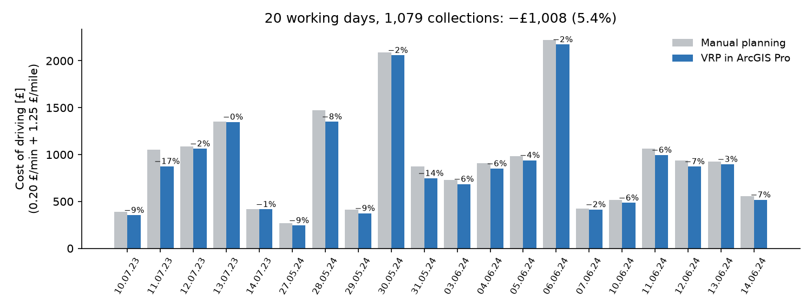
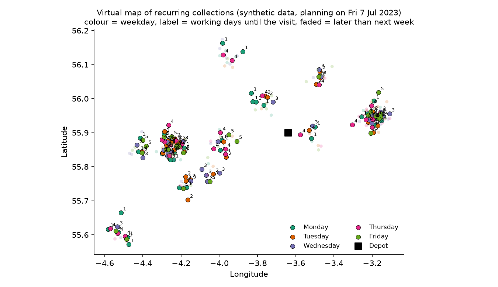
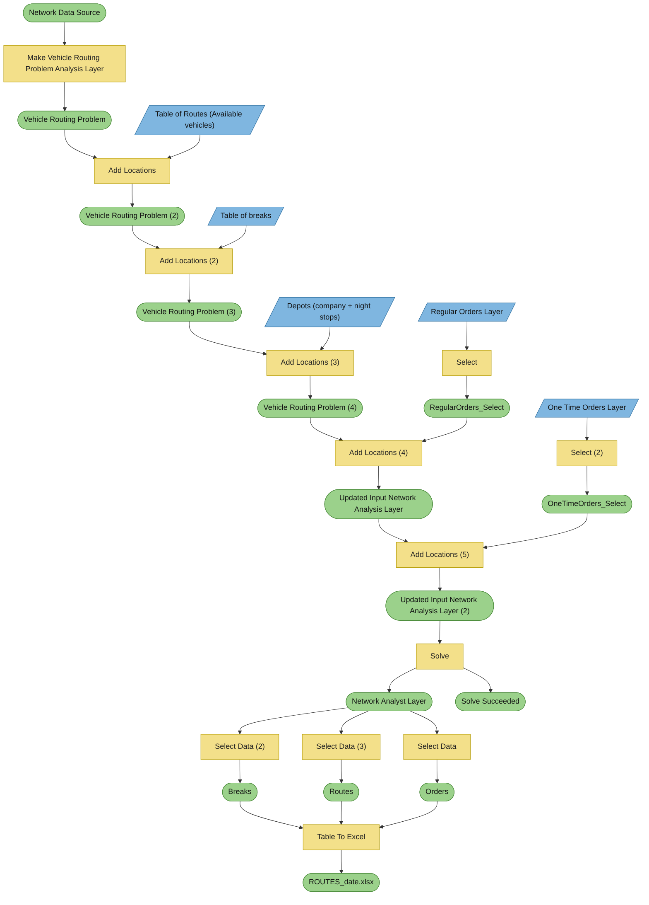
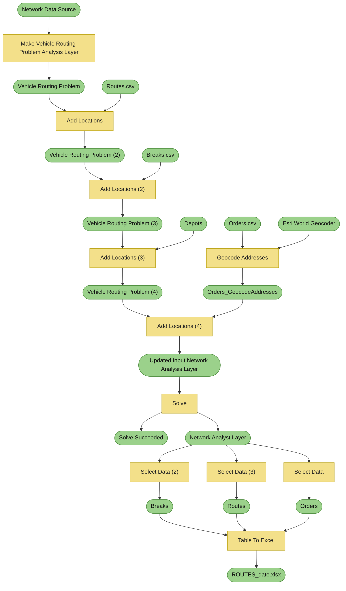
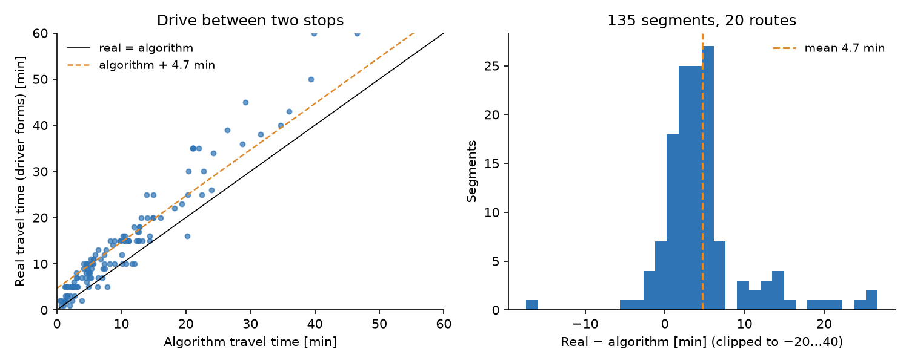

# Planowanie tras floty w ArcGIS Pro (Vehicle Routing Problem)

🇬🇧 [English version](README.md) · 🇵🇱 **Polski**

[](https://github.com/MalickiJacek/fleet-routing-vrp-arcgis/actions/workflows/ci.yml)


Projekt z mojej pracy magisterskiej: system GIS, który zastąpił ręczne planowanie tras w szkockiej firmie odbierającej makulaturę. Przetestowałem go na **20 dniach roboczych i 1079 rzeczywistych odbiorach**. Obniżył koszt jazdy o **5,4%** względem tras planowanych ręcznie, a dzienne planowanie skrócił z ok. 3 godzin do 30 minut.

> Malicki J. (2024). *Application of network analysis for management of fleet of vehicles in a company transporting waste paper.* Praca magisterska, Geomatyka, Politechnika Wrocławska. Promotor: dr hab. inż. Jan Blachowski.



## Problem

Firma odbiera dokumenty do niszczenia z kilkuset biur, szpitali i sklepów, mając ok. 9 samochodów dostawczych i ciężarowych. Mniej więcej połowa odbiorów się powtarza (co tydzień, co 2, 4 lub 6 tygodni), druga połowa to zlecenia jednorazowe, realizowane zwykle w ciągu 48 godzin.

Przed projektem:
- **Przyjmowanie zlecenia:** dyspozytor sprawdzał, gdzie będą auta w kolejnych dniach, na papierowej mapie 150 × 80 cm, w Google Maps i w CRM.
- **Planowanie dnia:** co wieczór koordynator dzielił zlecenia na następny dzień według kodów pocztowych, ręcznie układał kolejność w Google Maps i przepisywał trasy do CRM. Zajmowało to **ok. 3 godziny dziennie**.

## Rozwiązanie – trzy części

### 1. Wirtualna mapa zleceń cyklicznych

Wszystkie zlecenia stałe (702 w badaniu) zgeokodowałem do warstwy punktowej. Każdy rekord ma dzień odbioru, częstotliwość i datę ostatniej wizyty. Skrypt liczy z nich:
- `NextDate`: datę następnego odbioru;
- `DaysCount`: liczbę dni roboczych do tego odbioru.

Symbolizacja pokazuje dzień tygodnia kolorem, a odbiory dalsze niż tydzień roboczy są półprzezroczyste ([wyrażenie Arcade](arcpy/symbology_transparency.arcade)). Gdy klient dzwoni, dyspozytor od razu widzi, którego dnia auto i tak będzie w pobliżu.



### 2. Codzienny VRP w ArcGIS Pro, zautomatyzowany w ModelBuilderze

Co wieczór jeden model planuje następny dzień roboczy:

1. Wybiera zlecenia z `DaysCount = 1` oraz zlecenia jednorazowe na ten dzień.
2. Wczytuje je do warstwy **Vehicle Routing Problem** razem z:
   - **Routes:** dostępne pojazdy i kierowcy, trzy ładowności (worki, pojemniki 240 l, masa), koszt minuty i mili, limity czasu pracy, 30 minut na start i koniec w bazie;
   - **Breaks:** 15 min ok. 9:30 i 45 min ok. 13:00;
   - **Depots:** baza i opcjonalny nocleg przy kilkudniowych wyjazdach do Anglii.
3. Rozwiązuje problem i eksportuje jeden plik Excel dla kierowców: przystanki w kolejności z godzinami przyjazdu oraz podsumowanie każdej trasy.

Są dwa warianty: zlecenia z wirtualnej mapy albo z arkusza geokodowanego w locie.

| Wariant z wirtualną mapą | Wariant z arkuszem |
|---|---|
|  |  |

### 3. Weryfikacja na rzeczywistych czasach przejazdu

Przez tydzień kierowcy wypełniali formularze z godzinami przyjazdu i odjazdu na każdym przystanku: 20 tras i 231 przystanków. Po odrzuceniu odcinków bez kompletu godzin, o zerowej długości albo z przerwą wpisaną jako jazda zostało **135 odcinków**. Porównałem je z czasami policzonymi przez Network Analyst.

W 90% odcinków jazda w rzeczywistości trwała dłużej, **średnio o 4,7 minuty**. Składają się na to wyjazd z posesji, parkowanie i to, że dostawczaki jeżdżą wolniej niż samochody osobowe, pod które jest skalibrowana sieć drogowa. Tę wartość ustawiłem dla każdej trasy jako `ArriveDepartDelay`, dzięki czemu planowane godziny przyjazdu lepiej zgadzają się z rzeczywistością.



## Wyniki

Dla każdego z 20 dni roboczych (lipiec 2023 oraz maj–czerwiec 2024):
1. odtworzyłem w warstwie VRP trasy faktycznie zaplanowane ręcznie, z zachowaniem ich kolejności;
2. te same zlecenia rozwiązałem ponownie, tym razem pozwalając algorytmowi swobodnie przydzielić i ułożyć przystanki.

Do zgeokodowania 901 adresów z 2024 roku użyłem własnej aplikacji webowej opartej na OpenStreetMap Nominatim (zobacz też [geoplanner-route-optimizer](https://github.com/MalickiJacek/geoplanner-route-optimizer)). Automatycznie udało się zlokalizować 97% adresów. Koszty: 0,20 £ za minutę jazdy (kierowca 12 £/h) i 1,25 £ za milę.

| | Ręcznie | VRP | Różnica |
|---|---|---|---|
| Odbiory | 1079 | 1079 | |
| Czas jazdy | 18 008 min | 17 168 min | −840 min (−4,7%) |
| Dystans | 12 057 mil | 11 384 mil | −672 mil (−5,6%) |
| Koszt jazdy | 18 673 £ | 17 665 £ | **−1008 £ (−5,4%)** |

W skali roku (260 dni roboczych):

| Pozycja | Rocznie |
|---|---|
| Jazda | ok. 13 000 £ |
| Czas planisty (2,5 h dziennie) | 7800 £ |
| Licencja ArcGIS Pro z Network Analyst i dodatkowe kredyty | −2230 £ |
| **Oszczędność netto** | **ok. 18 500 £** |

Dane dzienne są w [`data/thesis/`](data/thesis/) (zagregowane, bez danych klientów). [`src/fleetvrp/analysis.py`](src/fleetvrp/analysis.py) przelicza wszystkie powyższe liczby, a testy je sprawdzają.

## Uruchomienie

**ArcGIS Pro** (Network Analyst; źródło sieci z ArcGIS Online zużywa kredyty): zobacz [`arcpy/README.md`](arcpy/README.md).

**Analizy i wykresy** (dowolny Python):

```bash
pip install -e ".[dev]"
pytest -q                         # 15 testów
python scripts/make_figures.py    # docs/img/*.png
```

## Dane i prywatność

Nazwy i adresy klientów oraz dane pojazdów firmy **nie są** publikowane. Wyniki pracy są pokazane wyłącznie jako zagregowane tabele. Dane przykładowe są syntetyczne ([`scripts/generate_sample_data.py`](scripts/generate_sample_data.py)), a zrzutów rzeczywistych tras z pracy tu nie ma.

## Technologie

**GIS:** ArcGIS Pro · Network Analyst (Vehicle Routing Problem) · ModelBuilder · ArcPy · Arcade · geokodowanie
**Python:** pandas · Matplotlib · pytest · GitHub Actions

## Autor

**Jacek Malicki**, programista GIS · [LinkedIn](https://www.linkedin.com/in/jacek-malicki-85b04a27b) · [GitHub](https://github.com/MalickiJacek)

Modele, analizy i wyniki pochodzą z mojej pracy magisterskiej (2023–2024). Wersje modeli w Pythonie, dane syntetyczne, testy i dokumentację przygotowałem w 2026 roku z pomocą AI (Claude).

## Licencja

[MIT](LICENSE)
